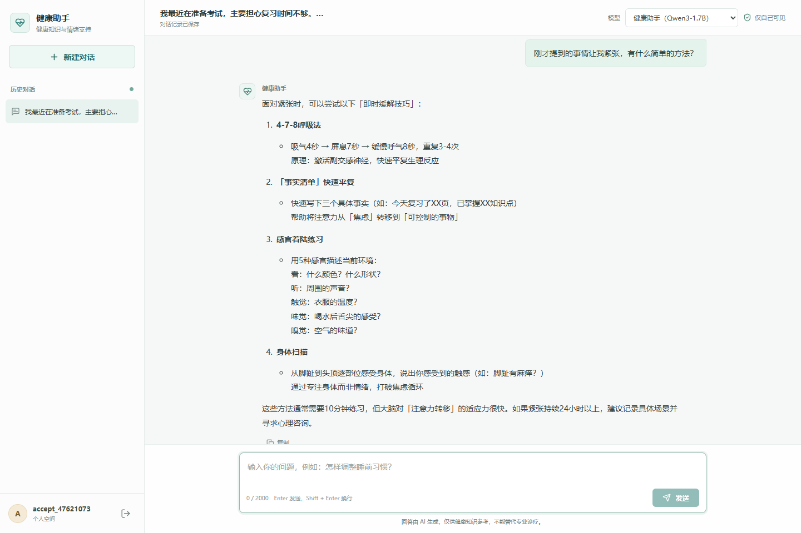

# 健康助手 SFT

基于 **Qwen3-1.7B + QLoRA** 的健康信息与情绪支持微调实验，配套 Vue 3 + FastAPI Web 应用。
项目在单张 8 GB 显存显卡上完成微调与本地推理，支持注册登录、多轮对话、流式输出、停止生成，
以及原始模型与微调模型切换，便于比较微调前后的回答行为。

> **当前是研究与功能演示版本。** 实际健康内容抽查未通过：模型可能给出错误用药信息或不当急救建议。
> 不可用于诊断、用药或急救决策，也不应作为面向真实用户的医疗服务。
> 具体结果见 [验收记录](webapp/验收记录.md) 和 [健康内容抽查](webapp/screenshots/A13-健康内容抽查.md)。

## 已实现功能

- 账号注册、登录、退出，以及按账号隔离的会话与聊天记录。
- 新建、恢复、删除会话；只将当前会话历史加入模型上下文。
- 流式回答、停止生成、失败重试和安全 Markdown 渲染。
- 同一份基础模型通过启用/关闭 LoRA 切换微调版与原始版，避免重复加载模型。
- 桌面和手机布局；模型选择按会话保存。
- 数据准备、训练配置、SwanLab（实验记录平台）接入和验收测试。

## 技术栈

| 层 | 技术 |
| --- | --- |
| 数据 | 清洗合成对话、按问题分组切分、转 LLaMA-Factory 格式 |
| 训练 | LLaMA-Factory + QLoRA（4 bit），试跑与正式训练两阶段 |
| 服务 | 基于 LLaMA-Factory 的推理服务，加载基础模型 + LoRA 适配器 |
| 应用 | FastAPI 后端（认证、会话、模型代理）+ Vue 3 前端 |

浏览器只访问同源 `/api`，模型地址与密钥只在后端读取；模型白名单只向浏览器暴露 ID 与显示名。

## 数据与模型

原始数据为合成对话（DeepSeek-R1 蒸馏），不是真实用户数据。

- 原始 8775 条，剔除空回答后保留 8774 条；
- 按「问题」分组切分以避免同题泄漏，随机种子 42，80% / 10% / 10%：
  训练 7037、验证 858、测试 879；
- 使用 `qwen3_nothink` 模板，只保留问题与最终回答；最长 1517 个词元，截断长度 1536。

**数据文件与模型权重未随包提供**（体积限制）。模型为 Qwen3-1.7B 加训练得到的 LoRA 适配器。

配置中的 `/home/woei/...` 是开发机器的本地路径，复现前需替换为自己的模型、数据与输出目录。
当前推理配置加载 `train_01`（首次正式训练结果）；`train_swanlab_01`（带 SwanLab 记录的训练结果）
尚未配置为网页的微调版本。原始版仍使用相同的健康助手系统提示词和四比特量化，比较时建议使用
不同的新会话发送相同问题。默认输出上限为 512 tokens（词元），输入上下文预算为 2048 tokens。

## 运行与复现

环境：Node.js 20+、Python 3.11、已安装 LLaMA-Factory 的模型环境，以及本地模型与 LoRA 权重。
开发机器通过 WSL Ubuntu 22.04 使用 NVIDIA CUDA；本应用不依赖 Docker。

1. 克隆仓库：`git clone https://github.com/buquegai/health-assistant-sft.git`。
2. 准备基础模型和兼容的未合并 LoRA 权重，修改 `configs/psychology_infer.yaml`（推理配置）中的路径。
3. 按 [Web 应用运行说明](webapp/README.md) 分别启动模型服务、应用后端和前端。已有 Python 环境可直接复用，无需重复创建；保留自己的 `.env`（本地配置）。
4. 浏览器访问 `http://localhost:5173`（本地开发地址），注册账号后开始对话。

训练入口与配置：

- `scripts/prepare_psychology_sft.py`（数据清洗与切分脚本），可通过 `--source`、`--output-dir`、`--model-path` 指定路径。
- `configs/psychology_smoke.yaml`（小样本试跑配置）与 `configs/psychology_sft.yaml`（正式微调配置）。
- `configs/psychology_sft_swanlab.yaml`（实验跟踪配置）与 `scripts/run_swanlab_train.py`（启动脚本），密钥从 `SWANLAB_API_KEY` 环境变量读取。

模型、数据集及第三方依赖需自行准备，并遵守其各自许可。仓库不包含用户数据库、聊天记录、访问密钥、
虚拟环境、依赖目录或训练权重；截图与验收文本使用合成测试内容。上传仓库本身不会部署在线聊天服务。

## 目录与验证

| 目录 | 内容 |
| --- | --- |
| `configs/` | 训练、试跑和推理配置 |
| `scripts/` | 数据准备与训练启动脚本 |
| `webapp/backend/` | FastAPI 后端、数据库模型及后端测试 |
| `webapp/frontend/` | Vue 前端和浏览器验收脚本 |
| `webapp/serve_model.py`、`webapp/model_variants.py` | 模型服务、停止机制和原始/微调模式切换 |
| `webapp/tests/` | LoRA 模式切换与恢复测试 |
| `docs/` | 功能需求和页面设计文档 |

前端目录执行 `npm run build`（生产构建）；后端目录执行 `python -m pytest -q`（后端测试）。
真实模型和浏览器验证方法、通过项及尚未完成项见 [运行说明](webapp/README.md) 与 [验收记录](webapp/验收记录.md)。
